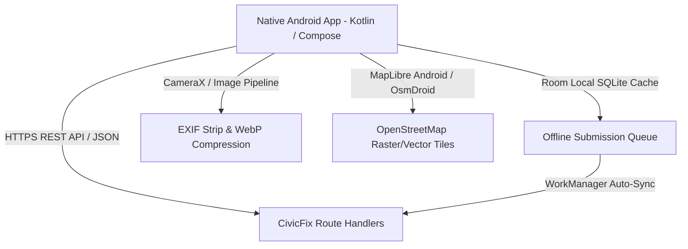

# CivicFix — Android Mobile Conversion Readiness Report

## 1. Executive Summary
The CivicFix platform is engineered with a clean decoupled architecture (Domain-Driven Design and RESTful API boundaries) that enables rapid conversion into a native or cross-platform Android mobile application.

---

## 2. API Compatibility & Endpoints
The backend REST Route Handlers are fully decoupled from browser HTML/JSX rendering, returning standardized JSON payloads and accepting standard JSON request bodies.

| Endpoint | Method | Mobile Payload / Headers | Android Mobile Usage |
| :--- | :--- | :--- | :--- |
| `/api/categories` | `GET` | None | Pre-fetches issue categories into Room cache for instant offline selection. |
| `/api/reports` | `GET` | Query: `west`, `south`, `east`, `north`, `category`, `status`, `limit` | Viewport bounding-box marker synchronization as user pans the native map. |
| `/api/reports` | `POST` | Body: `{ title, description, categoryId, latitude, longitude, approximateAddress, isLocationFuzzed, acceptedNonAffiliationDisclaimer: true }` | Citizen issue submission. Returns `CF-YYYY-XXXXXX` reference code. |
| `/api/reports/duplicate-check` | `POST` | Body: `{ categoryId, latitude, longitude, title, description }` | Real-time candidate duplicate preview while user types description. |
| `/api/reports/[ref]` | `GET` | Path: `ref` | Detailed issue permalink, photo gallery, and chronological status history. |
| `/api/moderation/flags` | `POST` | Body: `{ reportId, reason, details }` | Citizen in-app flag abuse / duplicate modal. |
| `/api/analytics` | `GET` | None | Public metrics and category breakdown statistics screen. |

---

## 3. Client-Side Mobile Architecture (Android)

### 3.1 Offline Sync via Room Database & WorkManager
- Urban infrastructure defects are frequently documented in areas with intermittent connectivity (tunnels, basements, rural roads).
- Reports created offline are persisted in a local Room SQLite entity (`DraftReportEntity`) with status `PENDING_SYNC`.
- Android `WorkManager` registers a periodic/network-constrained background worker (`SyncReportWorker`) with `NetworkType.CONNECTED` that drains the local draft queue automatically when connectivity resumes.

### 3.2 Geospatial Mapping Options on Android
1. **Option A: Native MapLibre Native SDK (Recommended)**:
   - High-performance 60fps vector tile rendering with GPU hardware acceleration.
   - Offline tile pack caching using `OfflineManager`.
   - Native marker clustering via GeoJSON source clustering (`cluster = true`).
2. **Option B: OsmDroid**:
   - Pure open-source OpenStreetMap rendering using standard OSM raster tiles matching the web tile provider (`NEXT_PUBLIC_MAP_TILE_URL`).
3. **Option C: WebView Hybrid Wrapper**:
   - Loads the existing `/map` web view inside an Android `WebView` with a JavaScript bridge interface (`@JavascriptInterface`) for native GPS coordination.

### 3.3 CameraX & Image Preparation Pipeline
- **Runtime Permissions**: Request `android.permission.CAMERA` and `android.permission.ACCESS_FINE_LOCATION` with graceful fallback to manual map pin selection if denied.
- **EXIF Sanitization**: Android `ExifInterface` strips GPS coordinates, camera serial numbers, and device manufacturer metadata before upload.
- **Compression**: Bitmaps compressed to WebP/JPEG format with `compress(Bitmap.CompressFormat.WEBP_LOSSY, 85, outputStream)`, guaranteeing file size $\le 5\text{ MB}$.

### 3.4 Mobile Security Hardening
- **Prohibited Credentials**: `SUPABASE_SERVICE_ROLE_KEY` must NEVER be embedded or obfuscated inside Android APK/AAB assets.
- **Token Storage**: User JWT tokens stored securely inside `EncryptedSharedPreferences` backed by the Android Keystore system.
- **Certificate Pinning**: OkHttp `CertificatePinner` configured on the API domain to prevent man-in-the-middle (MITM) proxy inspection.
