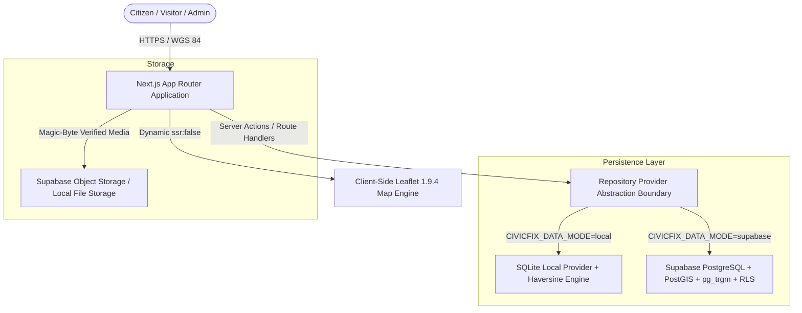

# High-Level Design (HLD) — CivicFix

## 1. System Context & Architecture
CivicFix is architected around a modern decoupled web tier with hybrid rendering and a dual-mode data persistence strategy.

## 2. Key Architecture Components

### 2.1 Next.js App Router Hybrid Tier
- **Server Components**: Render SEO-friendly public pages, tracking summaries, and initial server-side telemetry.
- **Client Components (`"use client"`)**: Isolated browser boundaries for interactive mapping (`CivicMapCanvas.tsx`), multi-step report wizard forms, and interactive triage workflows.
- **Route Handlers (`/app/api/...`)**: RESTful JSON endpoints with Zod schema validation, rate-limiting, and error envelopes.

### 2.2 Dual-Mode Persistence Strategy (ADR-001)
- **Local Provider (`SqliteCivicFixRepository`)**:
  - Embedded zero-dependency SQLite database.
  - Trigonometric Great-Circle (Haversine) distance calculations approximating spherical distances.
  - Character n-gram and trigram substring matching for duplicate scoring.
  - Self-seeding on initial startup.
- **Production Provider (`SupabaseCivicFixRepository`)**:
  - Full PostgreSQL 15+ database with `postgis`, `pg_trgm`, `pgcrypto`, and `pg_stat_statements`.
  - Native spherical `geography(Point, 4326)` and GiST indexing.
  - Database-enforced Row-Level Security (RLS) policies and triggers.

### 2.3 SSR Hydration Guard for Mapping (ADR-002)
- Leaflet requires `window` and `document` DOM globals.
- To prevent Next.js SSR hydration mismatches, map canvas modules are strictly loaded dynamically via `next/dynamic` with `{ ssr: false }`.
- Default Leaflet marker PNGs are replaced with programmatic SVG `divIcon` pins to prevent Webpack asset bundle breakage.

### 2.4 Deterministic Duplicate Engine (ADR-003)
- Multi-factor mathematical formula evaluating:
  1. Spatial Distance Decay ($S_{\text{geo}}$, 45% weight)
  2. Trigram Textual Similarity ($S_{\text{text}}$, 40% weight)
  3. Submission Time Decay ($S_{\text{time}}$, 15% weight)
- Flagged candidate pairs are quarantined in `report_flags` for human moderation without destructive auto-deletion.
