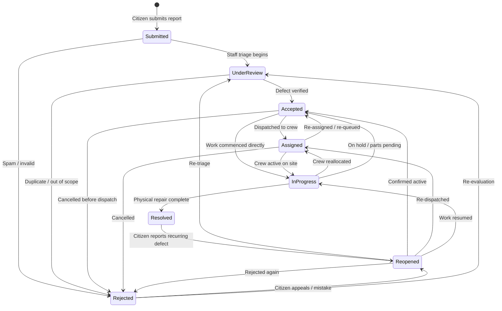

# CivicFix Issue Lifecycle Finite State Machine (FSM)

## 1. Overview
The CivicFix lifecycle model enforces an immutable, deterministic eight-state finite state machine. Every civic report follows this strict lifecycle. Direct state jumps (e.g. from `Submitted` directly to `Resolved`) are prohibited and rejected at both the application route and database trigger levels.

## 2. The Eight States and Semantic Definitions

| State Name | Semantic Meaning | Public Analytics Bucket | Authorized Actor Roles | Side Effects & Invariants |
| :--- | :--- | :--- | :--- | :--- |
| **Submitted** | Initial state immediately upon citizen submission. Unreviewed by staff or moderators. | Pending | `citizen`, `community_org`, `admin` | Genesis row written to `report_status_history`. Duplicate detection trigger runs. Citizen can still delete draft. |
| **Under review** | Report is undergoing initial triage, duplicate check, or content moderation. | Pending | `admin` (or staff reviewer) | Public rationale required. If duplicate confirmed, links `canonical_report_id` and moves to `Rejected`. |
| **Accepted** | Defect is verified as genuine, within platform scope, and queued for administrative dispatch. | Pending | `admin` | Confirms defect is non-spam and verifiable. Optionally creates `admin_assignments`. |
| **Assigned** | Report has been formally assigned to an internal municipal department or maintenance contractor. | Pending | `admin` | Department name and optional external tracking ticket recorded in `admin_assignments`. |
| **In progress** | Remediation crew or physical inspection is actively underway at the physical location. | Pending | `admin` | Appends public operational update notice in `report_updates`. |
| **Resolved** | Physical repair or remediation is completed and verified. | **Resolved** | `admin` | Sets `resolved_at = NOW()`. Calculates resolution duration (`resolved_at - created_at`). |
| **Rejected** | Closed without repair (e.g. duplicate, out of scope, invalid location, spam/abuse). | **Closed** | `admin` | Sets `closed_at = NOW()`. Requires mandatory rejection reason. Never counted as resolved. |
| **Reopened** | Previously resolved or rejected defect failed community verification or recurred. | Pending | `admin` | Clears `resolved_at` and `closed_at`. Increments `reopen_count`. Logs verification failure reason. |

## 3. State Transition Matrix



### 3.1 Allowed Transitions Map
```typescript
export const VALID_STATE_TRANSITIONS: Record<ReportStatus, readonly ReportStatus[]> = {
  Submitted: ["Under review", "Rejected"],
  "Under review": ["Accepted", "Rejected"],
  Accepted: ["Assigned", "In progress", "Rejected"],
  Assigned: ["In progress", "Accepted", "Rejected"],
  "In progress": ["Resolved", "Assigned", "Accepted"],
  Resolved: ["Reopened"],
  Rejected: ["Reopened", "Under review"],
  Reopened: ["Under review", "Accepted", "Assigned", "In progress", "Rejected"],
};
```

## 4. Invalid Transitions and Defense-in-Depth Rejections

### Examples of Prohibited Transitions
1. `Submitted` $\to$ `Resolved`: **REJECTED.** A report cannot jump straight to resolved without review, acceptance, and progress tracking.
2. `Submitted` $\to$ `In progress`: **REJECTED.** Must be triaged under review and accepted first.
3. `Resolved` $\to$ `Accepted`: **REJECTED.** A resolved issue cannot return to accepted without being formally `Reopened`.
4. Citizen attempting to mutate status to `Accepted` or `Resolved`: **REJECTED.** Route Handler checks role = `admin` AND database BEFORE UPDATE trigger checks role is `admin`.

## 5. Audit Logging Invariants
Every valid transition MUST atomically insert a row into `report_status_history`:
- `report_id`
- `previous_status`
- `new_status`
- `changed_by` (admin user ID)
- `public_rationale` (mandatory, min 5 chars, max 1000 chars)
- `created_at` (timestamp)
