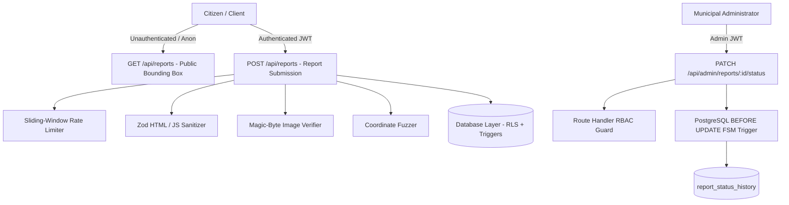

# Threat Model & Security Architecture — CivicFix

## 1. Threat Modeling Methodology: STRIDE & OWASP Top 10

CivicFix operates as an open, public civic tracking platform where public visibility must be reconciled with user privacy, anti-spam resilience, and access control.

---

## 2. STRIDE Threat Analysis Matrix

| Threat Category | Attack Vector & Scenario | Impact Severity | Preventative Architecture & Mitigation in CivicFix |
| :--- | :--- | :--- | :--- |
| **Spoofing** | Attacker spoofs municipal authority or claims administrative role by mutating their own profile via `PATCH /rest/v1/profiles`. | **Critical** | Database `BEFORE UPDATE` trigger `protect_profile_security_columns` on `profiles` raises exception `42501` if `role`, `is_banned`, or `is_verified_authority` is modified by anyone other than `service_role`. |
| **Tampering** | Citizen modifies report status directly to `Resolved` or bypasses required workflow states. | **High** | Route Handler verifies user session and admin role; PostgreSQL RLS limits report updates to staff; BEFORE UPDATE trigger `enforce_report_status_transition` validates state machine matrix. |
| **Repudiation** | Administrator or moderator alters status or closes an issue without accountability. | **Medium** | Immutable append-only audit trail in `report_status_history`. Every change requires a non-empty `public_rationale` and stores user ID + timestamp. |
| **Information Disclosure** | Public map API or database leaks citizen reporter email, phone number, exact residence coordinates, or private municipal notes. | **Critical** | Public RPCs (`search_reports_in_bbox`) omit `reporter_id` and contact information; sensitive categories automatically fuzz coordinates to 3 decimal places (~110m); `report_updates` partitions public vs private (`is_public = false`) internal notes protected by RLS. |
| **Denial of Service** | Botnet floods the map with thousands of bogus potholes or massive image files to exhaust disk and database memory. | **High** | Sliding-window rate limit (max 5 submissions per 15 minutes per reporter ID and SHA-256 IP hash); strict 5 MB file size limit; hard coordinate checks rejecting Null Island `(0, 0)`. |
| **Elevation of Privilege** | Normal citizen creates moderation events or accesses administrative triage endpoints. | **Critical** | Zero-trust validation at Route Handler layer (`auth.getUser()`, role verification) + Row-Level Security policies on `admin_assignments`, `moderation_events`, and `reports`. |

---

## 3. OWASP Top 10 Security Controls

1. **A01: Broken Access Control**:
   - Column-level trigger protection against self-role elevation.
   - Strict separation of public RPCs from internal admin tables.
   - Row-Level Security (RLS) policies on all 9 Supabase tables.
2. **A02: Cryptographic Failures**:
   - Complaint references generated cryptographically (`CF-YYYY-XXXXXX`).
   - Client IP addresses hashed with secret salt using SHA-256 before storage.
   - Media uploaded to secure bucket paths with SHA-256 integrity checksums.
3. **A03: Injection (SQL & Stored XSS)**:
   - Server-side HTML tag, `<script>`, and event-handler stripping in Zod validation pipe.
   - Parameterized SQL queries in SQLite provider and PostgreSQL RPCs; zero raw string concatenation.
4. **A04: Insecure Design**:
   - Non-affiliation disclaimer required by contract (`acceptedNonAffiliationDisclaimer: true`).
   - Potential duplicates quarantined rather than auto-deleted.
5. **A05: Security Misconfiguration**:
   - Production HTTP security headers: Content-Security-Policy (CSP), Strict-Transport-Security, X-Frame-Options: DENY, X-Content-Type-Options: nosniff.
   - Leaflet tile URLs externalized with explicit attribution.
6. **A06: Vulnerable & Outdated Components**:
   - Pinned Leaflet to stable 1.9.4.
   - React 19 / Next.js 15 verified dependency matrix.
7. **A07: Identification & Authentication Failures**:
   - Supabase Auth JWT token verification on server side.
   - Session tokens never exposed to client logs.
8. **A08: Software & Data Integrity Failures**:
   - Binary magic-byte validation verifying JPEG (`FF D8 FF`), PNG (`89 50 4E 47`), and WebP (`RIFF....WEBP`).
   - Rejection of SVG/HTML polyglot files disguised as image extensions.
9. **A09: Security Logging & Monitoring**:
   - Immutable `report_status_history` and `moderation_events` tracking all administrative actions.
10. **A10: Server-Side Request Forgery (SSRF)**:
    - No external user-provided URLs are fetched or evaluated server-side.
